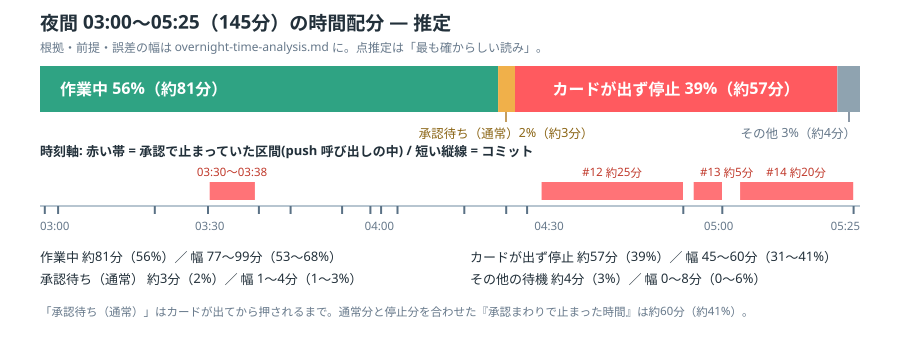

# 夜間(2026-11-07 03:00〜05:25)の時間配分 — 計算の過程

改善14件プログラムを実行した 145 分を、「作業中」「承認待ち(通常)」
「承認カードが出ず止まった時間」「その他の待機」に分けた推定。
結論の図は `overnight-time-chart.svg`。

## 結論(点推定)

| 区分 | 時間 | 比率 | 幅(ありうる範囲) |
|---|---|---|---|
| 作業中 | 約81分 | 56% | 77〜99分(53〜68%) |
| 承認待ち(通常) | 約3分 | 2% | 1〜4分(1〜3%) |
| カードが出ず停止 | 約57分 | 39% | 45〜60分(31〜41%) |
| その他の待機 | 約4分 | 3% | 0〜8分(0〜6%) |
| 合計 | 145分 | 100% | |

陽太さんの「承認待ちがかなりの割合を占めていた気がする」は、**通常の承認待ち
(カードが出てから押されるまで)だけなら約2%で小さい**が、**カードが出ずに
止まった分まで含めた「承認まわりで止まった時間」は約60分・約41%** で、
感覚は実態に合っている。止まった時間のほとんどは「押すのが遅い」ではなく
「PC 画面にカードが出ていない」時間だった。

## 材料

1. **見張りの記録の抜粋**(`handoff/overnight-timeline.json`、branch
   `claude/overnight-data`): 承認カードを押した時刻 16 回分と、起床(wake)の記録。
   注記に「見張りは画面を15秒おきに確認し、カードが出てから押すまで最大約15秒」
   「03:30〜03:38 はカードが画面に出ず、Muse が約8分止まった」とある。
2. **main のコミット履歴**: 窓の中のコミット 16 件(14件 + 途中の修正2件)の
   時刻。16 件は押された承認 16 回と一致する。
3. **Muse 自身の記録**(`claude-bridge/muse-view-2026-11-07.md` と、同日朝に
   Claude へ答えた発言): push 呼び出しの「開始→結果が返るまで」の実測が
   #11 約23秒 / #13 約5分 / #12 約25分 / #14 約20分。push 呼び出しは承認が
   返るまでブロックされるので、この所要の大半は承認待ち。

## 前提

- P1. 窓は指示どおり 03:00〜05:25 = 145 分。#1 の作業自体は 02:57 の指示から
  始まっているが、窓の外は数えない。
- P2. コミット時刻は GitHub 側でコミットが作られた時刻 ≒ push 完了。
  「押した時刻」との差は数秒(例: 03:00:47 に押して 03:00:51 にコミット)。
- P3. 通常の承認待ちは1回あたり最大約15秒(材料1の注記)。push の実行自体は
  数秒(昼間の実験 E1〜E5 で、push と読み取りの差は約3〜11秒だった)。
- P4. 材料3の push 所要(約5分/約25分/約20分)は、通常分(最大15秒)を引いても
  分単位で残る。これは「カードが出ず(押せず)止まった時間」とみなす。
- P5. 見張りの記録は「押した時刻」しか持たず、「カードが出た時刻」は無い。
  したがって区間の内訳(作業か停止か)の分離は材料3の実測に依る。
  **ここが最大の不確かさ**で、幅はそれを見込んである。

## サイクルごとの内訳(コミットから次のコミットまで)

| 区間 | 長さ | 読み |
|---|---|---|
| 03:00:00 → #1 電卓 03:00:51 | 0.9分 | 窓の頭。作業は 02:57 から継続中 |
| #1 → 修正(ツールチップ) 03:03:14 | 2.4分 | 作業 |
| → #2 圧縮 03:20:16 | 17.0分 | 作業(実装+VMテストが重い回) |
| → #3 パレット 03:29:39 | 9.4分 | 作業 |
| → 修正(見張り行) 03:38:42 | 9.0分 | **うち約8分が停止**(03:30〜03:38、材料1) |
| → #4 frecency 03:44:19 | 5.6分 | 作業 |
| → #5 プレビュー 03:53:22 | 9.1分 | 作業 |
| → #6 色分け 03:58:22 | 5.0分 | 作業 |
| → #7 既定アプリ 04:00:19 | 2.0分 | 作業 |
| → #8 カーソル 04:03:14 | 2.9分 | 作業 |
| → #9 テンプレート 04:15:00 | 11.8分 | 作業 |
| → #10 ダイアログ 04:22:24 | 7.4分 | 作業 |
| → #11 巨大ファイル 04:26:06 | 3.7分 | うち push 約23秒(材料3。通常寄り) |
| → #12 ブックマーク 04:53:41 | 27.6分 | **うち push 約25分が停止**。残り約2.6分が作業 |
| → #13 横断検索 05:00:37 | 7.0分 | **うち push 約5分が停止**。残り約2分が作業 |
| → #14 SFTP/Web 05:23:48 | 23.2分 | **うち push 約20分が停止**。残り約3.2分が作業 |
| → 05:25:00 | 1.2分 | 窓の尻尾(報告など) |

## 集計の仕方

- 停止: 8 + 25 + 5 + 20 = 58 分の push 停止から、通常分(4回 × 最大15秒 = 最大1分)
  を差し引いて約57分。材料3の「約」は分の単位の丸めなので、幅は 45〜60 分とした
  (各回の上限はサイクル長で決まる: #12 は 27.6 分、#14 は 23.2 分、#13 は 7.0 分)。
- 承認待ち(通常): 16 回 × 平均10秒前後 ≒ 約3分(上限は 16 × 15秒 + 実行分で約4分)。
- その他の待機: 窓の頭 0.9 分・尻尾 1.2 分と、起床→応答の間合いなど、上の
  どこにも入らない残差を寄せて約4分。**根拠が最も弱い区分**で、0〜8分の幅を付けた。
- 作業中: 残り全部(145 − 57 − 3 − 4 = 81 分)。実装・VM テスト・push 準備・
  1行報告の作成を含む。

## 別の読み(シナリオB)を採らなかった理由

見張りの記録(材料1)だけを見ると、明記された停止は 03:30〜03:38 の約8分だけで、
承認まわりは最大でも 8 + 16×0.25 ≒ 12 分(約8%)にしかならない。この読みでは
#12 の 27.6 分は全て作業になる。しかし材料1は「押した時刻」の記録でしかなく、
カードが出ていない時間は記録に現れない(出ていないものは押せないので、押した
時刻が遅れる形でしか残らない)。一方、材料3は当日の朝にセッションの記録から
測った push 所要で、#12 の push だけで約25分ブロックされたことを示している。
「複数回、数分単位で停止した」という muse-view の総括とも一致するので、
こちらを主たる根拠にした。ただし材料3は Muse の自己申告ベースの「約」値で、
第三者の生ログではない。その分、幅を広めに取ってある。

## 誤差と限界

- 材料3の「約5分/約25分/約20分」は分単位の丸め。停止の点推定 57 分は
  ±10 分程度の揺れがありうる(幅 45〜60 分と提示)。
- #12 の作業時間(約2.6分)は「サイクル長 − push 所要」の残差で、直接の
  測定ではない。小さい項目(#6→#7 が 2.0 分)と同じ桁ではある。
- 見張りの起床は 21 回あり、その応答の間合い(Claude が確認して、必要なら
  つつく)は「その他の待機」と「作業中」に分散していて、分離できていない。
- 03:30〜03:38 の停止 1 件だけは、見張り側の記録でも裏付けがある。
